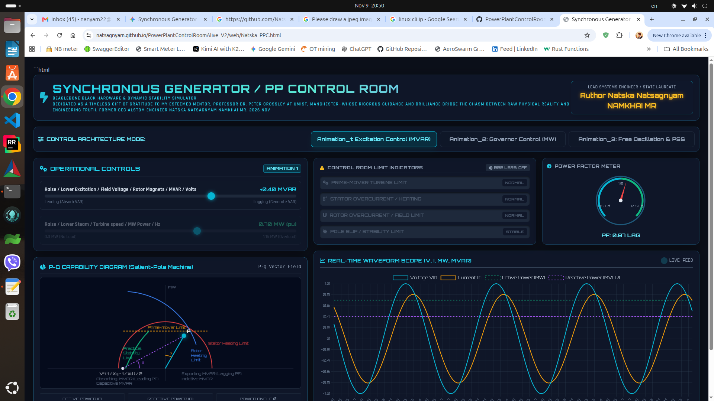

# Synchronous Generator & Power Plant Control Room Alive (v2.0)
# Try it for free   https://natsagnyam.github.io/PowerPlantControlRoomAlive_V2/web/Natska_PPC.html 

> **🌍 Global Open-Source Educational Access:**  
> Students and professors can instantly access and test the live interactive control room in any browser:  
> 👉 **[Launch Live Web Dashboard](https://natsagnyam.github.io/PowerPlantControlRoomAlive_V2/web/Natska_PPC.html)**
>
> **Author & Credentials:**  
> **State Laureate Natsagnyam NAMKHAI**  
> *Firmware & Power Systems Engineer | 2015 APO Regional Innovation Champion (awarded alongside Samsung Executive Chairman Boo-Keun Yoon)*  
> 
> **Dedication:**  
> *"Dedicated as a timeless gift of gratitude to my esteemed mentor, Professor Dr. Peter Crossley at UMIST, Manchester—whose rigorous guidance and brilliance bridge the chasm between raw physical reality and engineering truth."*

---

## 🌐 Dashboard Preview & Quick Start Instructions


### How Students & Lecturers Can Interact with the Simulator:
1. **Open the Global Link:** Navigate to `https://natsagnyam.github.io/PowerPlantControlRoomAlive_V2/web/Natska_PPC.html` in any desktop or tablet browser.
2. **Select Control Mode:** Switch between **Animation_1 (Excitation Control / MVAR)**, **Animation_2 (Governor Control / MW)**, and **Animation_3 (Free Oscillation & PSS)** at the top bar.
3. **Adjust Operational Controls:**
   - **Raise / Lower Excitation (MVAR / Field Voltage):** Shifts the current waveform phase angle ($\phi$) relative to voltage without altering peak amplitude.
   - **Raise / Lower Steam (MW / Power):** Scales the armature current magnitude ($I$) directly while maintaining the correct phase relationship.
4. **Observe Real-Time Physics:**
   - **P-Q Capability Diagram:** Tracks dynamic operation within prime-mover, rotor heating, and stator heating limits.
   - **Real-Time Waveform Scope:** Displays voltage ($V$), current ($I$), MW, and MVAR waveforms concurrently.
   - **Power Factor Meter:** Displays live lagging/leading power factor status.

---

## ⚡ Overview

**PowerPlantControlRoomAlive_V2** is a high-performance, hardware-independent open-source power plant control room simulation and telemetry daemon. Designed from first principles to correct common academic textbook approximations, this tool accurately models synchronous generator dynamics in real time.

Built with a native lightweight C socket server daemon (`src/telemetry.c`), it serves raw JSON telemetry and the real-time HTML5 capability diagram (`web/Natska_PPC.html`) on **port 9000** with zero external server dependencies.

---

## 📂 Repository Structure

```text
PowerPlantControlRoomAlive_V2/
├── src/               # C source code (telemetry daemon, socket server, control logic)
├── include/           # Header files and hardware control definitions
├── web/               # Real-time web UI dashboard (Natska_PPC.html)
├── Makefile           # Build automation configuration
├── Dockerfile         # Alpine-based container configuration for global portability
├── deployment.yaml    # Kubernetes deployment and service manifests
└── README.md          # Project documentation and usage guide
🚀 Execution & Deployment Options
1. Instant Global Web View (GitHub Pages)
Direct Browser Access: https://natsagnyam.github.io/PowerPlantControlRoomAlive_V2/web/Natska_PPC.html

2. Tailscale Telemetry Connection
If connected to the live C daemon running on embedded hardware via Tailscale:

Tailscale Secure IP Endpoint: http://100.114.205.29:9000

3. Run Natively (BeagleBone Black / Linux)
Bash
git clone [https://github.com/Natsagnyam/PowerPlantControlRoomAlive_V2.git](https://github.com/Natsagnyam/PowerPlantControlRoomAlive_V2.git)
cd PowerPlantControlRoomAlive_V2
make clean && make
sudo ./bbb_gen_ctrl
4. Run via Docker
Bash
docker build -t powerplant-ctrl-v2 .
docker run -d -p 9000:9000 --name powerplant-lab powerplant-ctrl-v2
📜 Open Educational Resource (OER) License
Released freely into the global public domain as an educational gift to empower students worldwide and bridge physical reality with engineering truth.

“Truth in engineering is found in physical reality, not abstract approximations.”
